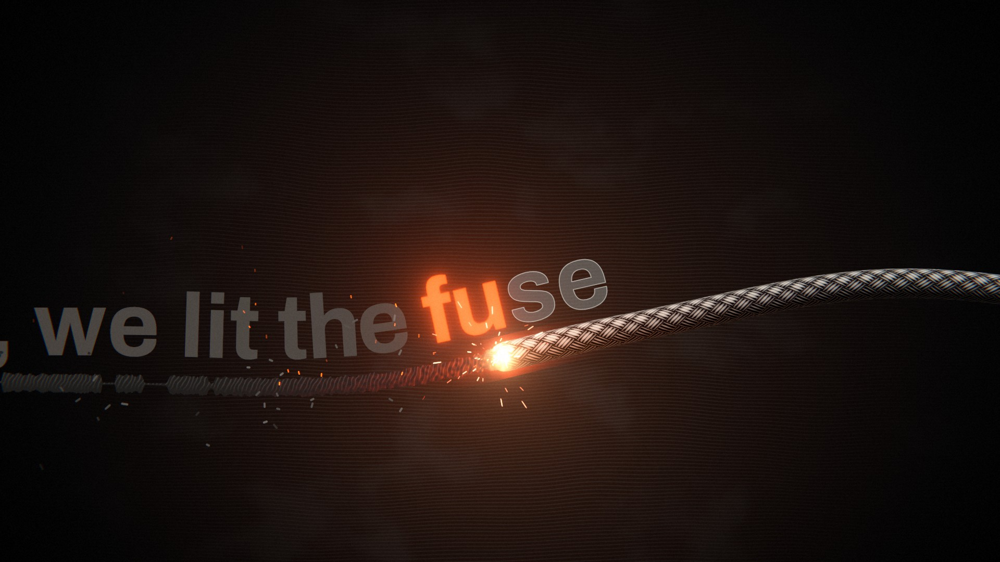
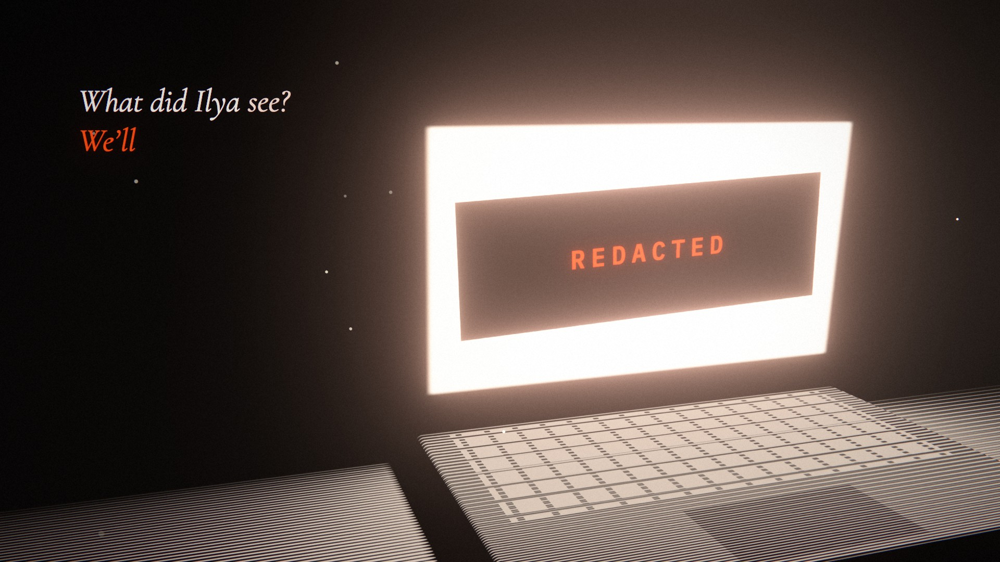

# code-mv-render

> 代码渲染 MV 工程库 —— 两支"确定性音乐视频"开源参考工程：帧 = f(歌曲时间)，浏览器预览与离线导出逐帧一致

## 简介

本 Skill 收录两支持续开源的**代码渲染音乐视频工程**，它们共用同一条底层原理——**每一帧只是歌曲时间的函数**（`renderFrame(t)`）：不读系统时钟、不留跨帧状态，所以浏览器里的实时预览与无头 Chrome 的离线导出逐帧一致，可反复复现、可逐帧质检、可按音频时间精确定位。

要做一个带音轨、逐帧确定的整片 MV / 歌词视频 / 生成式视觉时，从这里选一支最贴近的工程 fork / 改编，而不是从零搭渲染管线。配套 `references/` 两份规范摘录（画面法则、颜色状态、节拍对齐、运动模糊采样、导出管线、闪光安全）。

与 `video-shot-demos` / `swiss-shot-demos` 的边界：那两者是"一镜一 HTML"的演示片段；本 Skill 管的是**从音轨到成片的整条工程链**（音轨分析 → 时间线 → 场景 → 预览 → 导出 → 质检）。

## 两支参考工程

| | **world-execute-me-lyric-mv** | **pdoom-video** |
|---|---|---|
| 影片 | Mili《world.execute(me);》歌词 MV（第四版） | "I'm Upping My P(doom)" 生成式 MV |
| 类型 | 歌词 MV · 对话叙事 | 生成式 MV · 逐字卡拉 OK 排版 |
| 画面技术 | Canvas 2D + WebGL2 | three.js + TypeScript |
| 画面语言 | 聊天**界面** / 暗暖纸底三墨**版画** / **代码**（EXECUTION 段） | 每片一模块：线画独角兽、纸表单、霓虹红屏、燃烧引线… |
| 核心机制 | **颜色 = 状态**；字体按角色分工；成品级闪光安全 | **按块自适应子帧采样**的运动模糊；节拍吸附场景窗口 |
| 音画同步 | 行级歌词时间 + 独立 `cues` 拍点；LRC 自动填词 | Demucs 分轨 + CTC↔Whisper 交叉对齐；词级时间 |
| 导出 | 无头 Chrome 逐帧 → ffmpeg（1080p60 / 4K60） | 无头 Chrome → WebSocket 原始帧 → ffmpeg（1080p60 / 4K60） |
| 环境 | Node.js 20+，Windows 11（Chrome/Edge） | bun + Vite，Chrome + ffmpeg；分析需 uv |
| 源码 | github.com/Nyankomintsu/world-execute-me-lyric-mv | github.com/mexicat/pdoom-video |

> 两支工程的**歌曲与歌词都不在仓库内**、也不在代码许可之内——使用时须自备音轨与歌词，发布须遵循原作者版权指引。

## 核心机制（抽取给自建工程）

| 机制 | 说明 |
|------|------|
| **确定性渲染** | `renderFrame(t)` 只依赖时间；PRNG 种子化；字体/图形首帧前一次性预处理，渲染时不回读像素 |
| **单一时间基准** | 全片以"歌曲时间"为准（音轨起点 = 0）；片头警告页置于负时间，绝不移动拍点 |
| **拍点集中管理** | 行级/词级时间一张表；不在拍上的单字、音节、鼓点集中在单个 `cues` 文件里凭耳朵修 |
| **颜色 = 状态** | 调色板是状态不是风格：角色色随剧情事件切换，观众靠颜色跨页追踪同一实体 |
| **块级自适应运动模糊** | 画面切 32×32 块，静止 12 / 运镜 36 / 甩镜爆闪 108–324 采样，块收敛后跳过——快物体压静止背景近乎零额外开销 |
| **预览 = 导出** | 预览器复用导出帧函数，杜绝"预览好看导出差" |
| **闪光安全自检** | config 内 `maxFlash/flashRange/preroll`；导出后按 WCAG 2.3.1（一秒内大面积亮度往返 ≤3 次 + 红色闪烁独立）逐像素统计 |

## 使用方式

```
我要做一个 Mili《world.execute(me);》风格的歌词 MV，用 world-execute-me-lyric-mv 那支工程——
对话叙事、三墨版画、颜色=状态的画面法则，帮我理清从音轨到 4K 导出的完整流程和要改的模块
```

```
我有一首歌想做成生成式 MV，偏 pdoom-video 那种逐字卡拉OK排版 + GPU 场景 + 运动模糊——
告诉我怎么对齐歌词时间、怎么按块调子帧采样、导出命令怎么写，以及闪光安全的红线
```

```
帮我对比这两支工程：同样是"帧由歌曲时间决定"，画面语言和渲染管线各有什么取舍，
如果我的内容是【一段对话 / 一段抽象论说】，应该选哪支？
```

## 预览

<table>
<tr>
<td align="center" width="60%"><br /><sub><b>world-execute-me-lyric-mv</b><br />橙/米白/近黑 三墨版画 · 聊天界面与角色剪影</sub></td>
<td align="center" width="40%"><br /><sub><b>pdoom-video</b><br />线画场景 + 逐字排版（SHOGGOTH'S LIES.）</sub></td>
</tr>
<tr>
<td align="center" width="40%"><br /><sub>发光线画 + 卡拉OK大字（Your circuits make me nervous.）</sub></td>
<td align="center" width="60%"><br /><sub>纸表单排版（FORM 7-B · SAFE ENOUGH 盖章）</sub></td>
</tr>
<tr>
<td align="center" width="60%"><br /><sub>极简暗底 + 燃烧引线（we lit the FUSE）</sub></td>
<td align="center" width="40%"><br /><sub>氛围光场 + 衬线旁白（REDACTED）</sub></td>
</tr>
</table>

<sub>↑ 6 张截帧预览：1 张为 world-execute-me-lyric-mv 封面，5 张为 pdoom-video 的 plates 静帧（图片取自各工程仓库，版权与署名见下）。</sub>

## 许可与署名（务必遵守）

| 项目 | 许可 |
|---|---|
| world-execute-me-lyric-mv 代码与自撰文档 | MIT |
| world-execute-me-lyric-mv 角色剪影（`assets/character/`）及含剪影画面 | **CC BY-NC-SA 4.0**（署名 Nyankomint，禁商用，同许可再分享） |
| world-execute-me-lyric-mv 歌曲与歌词 | 属 Mili 及相关权利人，**不在仓库**、不在上述许可内 |
| pdoom-video 代码 | MIT |
| pdoom-video 字体 | SIL OFL（Archivo / IBM Plex Mono / Cormorant Garamond / 单线条绘图字体） |
| pdoom-video 歌曲与歌词 | 不属 MIT，属原作者（歌词 osmarks / MusicPerson，Claude-Pop 版由 deckard 发布） |

两支工程均为**非官方同人作品**，与权利人无关；成片均标注"含 AI 生成内容"。发布时须照此声明。

## 技术栈

- **world-execute-me-lyric-mv**：Node.js 20+ · 浏览器 Canvas 2D + WebGL2 · 无头 Chrome（playwright-core）· ffmpeg-static
- **pdoom-video**：bun + Vite · TypeScript · three.js · 无头 Chrome · ffmpeg(libx264)；分析工具 Python(uv) + Demucs + Whisper

## 参考

- `references/world-execute-spec.md` · `references/pdoom-spec.md`（两份工程规范摘录）
- 上游：github.com/Nyankomintsu/world-execute-me-lyric-mv · github.com/mexicat/pdoom-video
