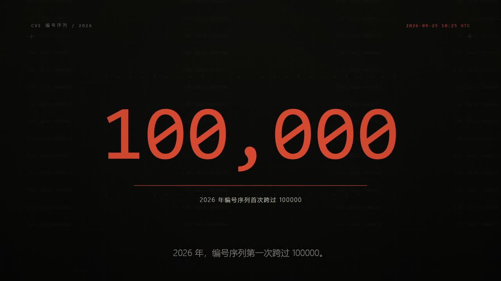
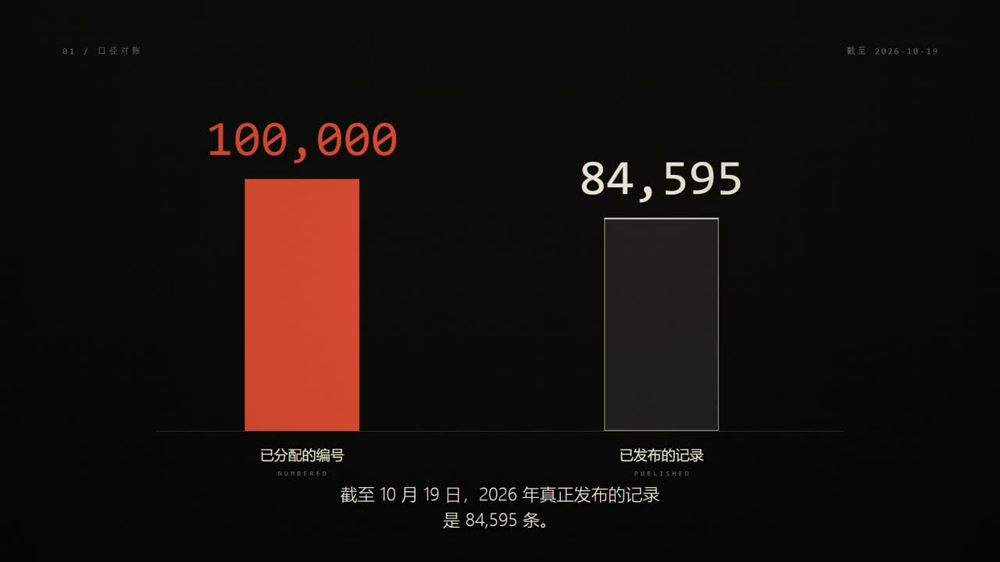
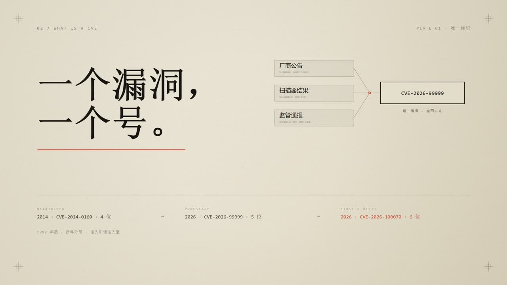
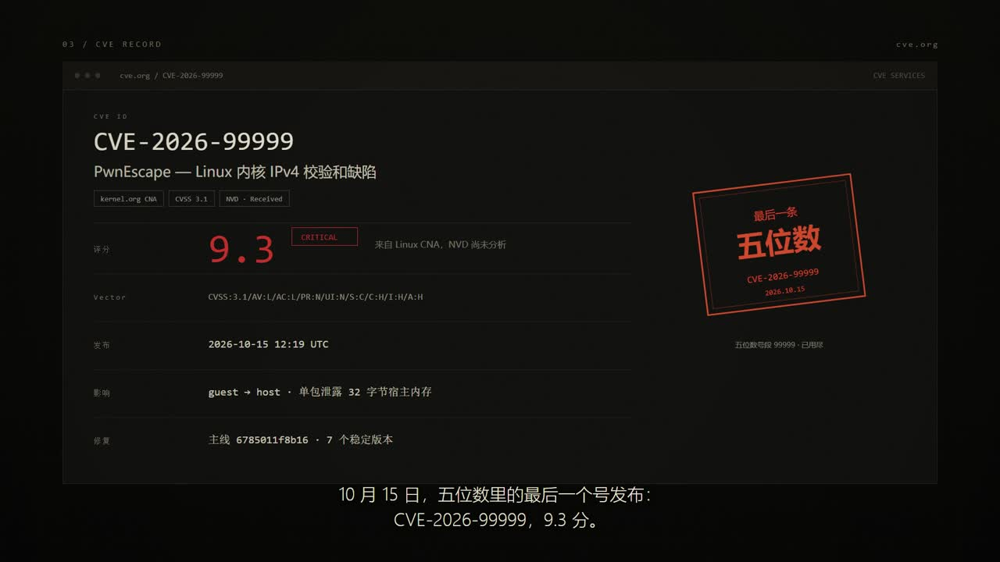
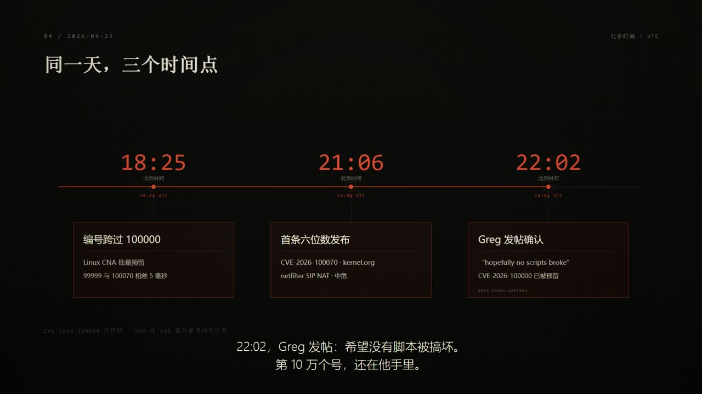
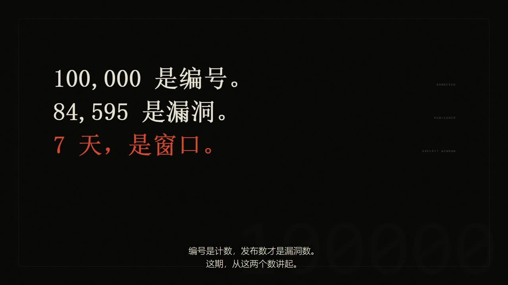
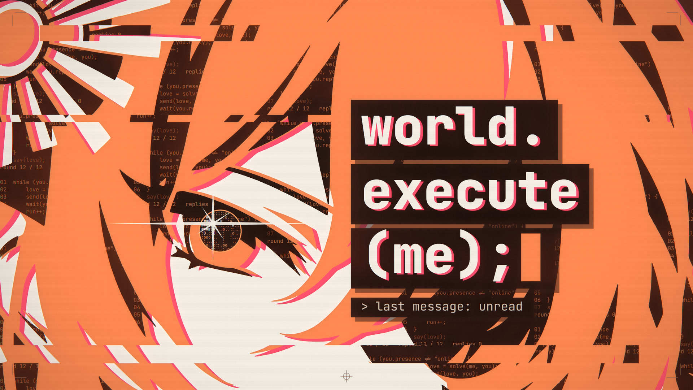
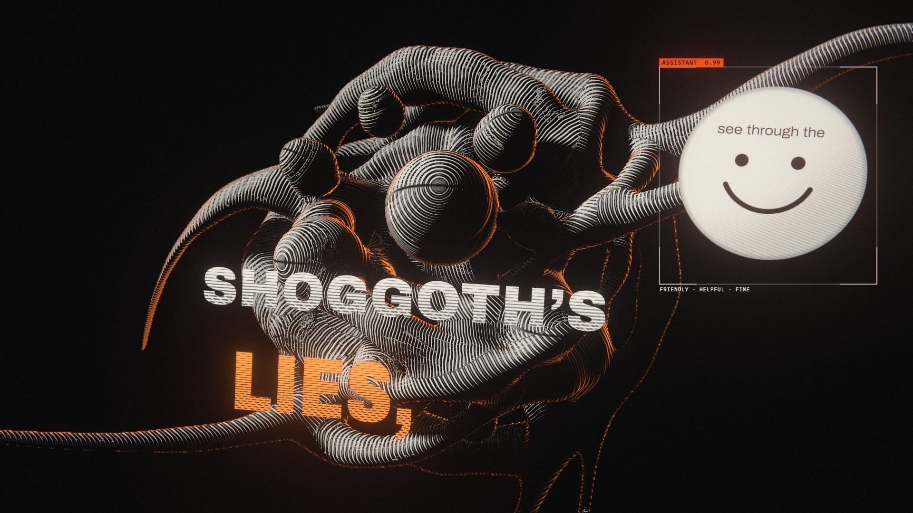
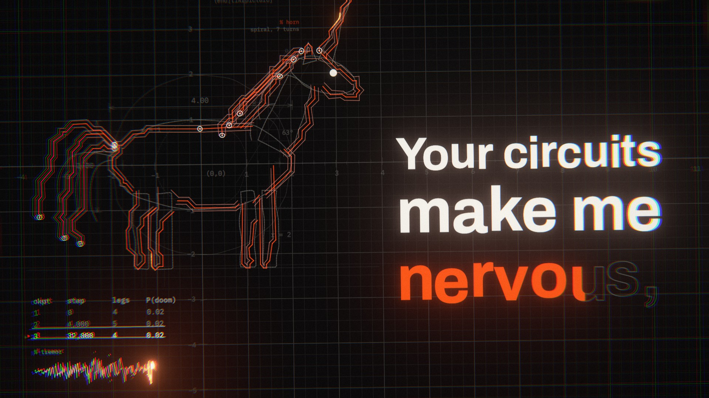
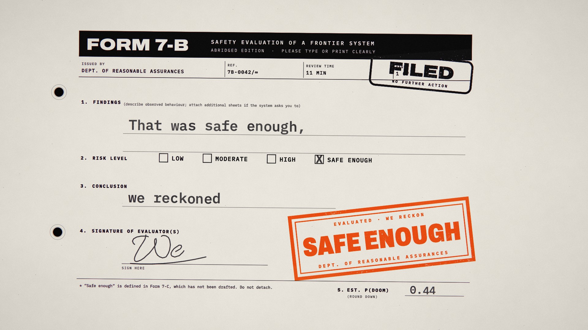

# code-mv-render

> 代码渲染 MV / 数据纪录片的确定性工程库 —— 帧 = f(时间)，浏览器预览与离线导出逐帧一致

## 简介

本 Skill 收录两支持续开源的**代码渲染音乐视频工程**，外加本库自建、已经导出成片的《CVE 编号破十万》90 秒数据纪录片实现。它们共用同一条底层原理——**每一帧只是时间的函数**（`renderFrame(t)`）：不读系统时钟、不留跨帧状态，所以浏览器里的实时预览与无头浏览器的离线导出逐帧一致，可反复复现、可逐帧质检、可按时间精确跳转。

要做一个带音轨或口播、逐帧确定的整片视频时，从这里选最贴近的路线 fork / 改编，而不是从零搭渲染管线。配套 `references/` 九份文档（画面法则、动效框架、引擎实现、Opus 导演/动态设计/审查、风格系统、案例、上游规范）与 `templates/` 五个可直接运行的文件。

与 `video-shot-demos` / `swiss-shot-demos` 的边界：那两者是"一镜一 HTML"的演示片段；本 Skill 管的是**从时间轴到成片的整条工程链**（时间基准 → 镜头 → 预览 → 导出 → 质检）。

## 三支参考工程

| | **world-execute-me-lyric-mv** | **pdoom-video** | **CVE 编号破十万（自建）** |
|---|---|---|---|
| 影片 | Mili《world.execute(me);》歌词 MV（第四版） | "I'm Upping My P(doom)" 生成式 MV | 《见证历史！CVE 编号首次破十万》90 秒演示 |
| 类型 | 歌词 MV · 对话叙事 | 生成式 MV · 逐字卡拉 OK 排版 | 数据纪录片 · 口播字幕驱动 |
| 画面技术 | Canvas 2D + WebGL2 | three.js + TypeScript | Canvas 2D · 单文件 HTML |
| 画面语言 | 聊天**界面** / 暗暖纸底三墨**版画** / **代码** | 每片一模块：线画、纸表单、霓虹屏、燃烧引线… | **数据** / **界面** / **版画** 三型交替 |
| 核心机制 | 颜色 = 状态；字体按角色分工；成品级闪光安全 | 块级自适应子帧运动模糊；节拍吸附场景窗口 | 镜头模型 + 15 转场 + 语义色 + 口播时间轴 |
| 音画同步 | 行级歌词时间 + 独立 `cues` 拍点；LRC 自动填词 | Demucs 分轨 + CTC↔Whisper 交叉对齐；词级时间 | 字幕段为主网格，句内事件为次网格 |
| 导出 | 无头 Chrome 逐帧 → ffmpeg（1080p60 / 4K60） | 无头 Chrome → WebSocket 帧 → ffmpeg | 无头 Edge + `captureStream` → WebM → ffmpeg |
| 环境 | Node.js 20+，Windows 11（Chrome/Edge） | bun + Vite，Chrome + ffmpeg；分析需 uv | 任意现代浏览器；导出需 Node + Edge/Chrome + ffmpeg |
| 源码 | github.com/Nyankomintsu/world-execute-me-lyric-mv | github.com/mexicat/pdoom-video | 本 Skill `examples/cve-100k/demo.html` |

> 两支上游的**歌曲与歌词都不在仓库内**、也不在代码许可之内——使用时须自备音轨与歌词，发布须遵循原作者版权指引。自建案例无此限制。

## 动效框架（本 Skill 的核心增量）

从上游 `PLAN.md` / `KIT.md` / `transitions.js` 抽取并落到模板里：

| 层 | 内容 |
|---|---|
| **镜头模型** | `{ at, moment, enter, camera, render(t) }`；切点落在拍/半拍/句边界；镜头内三拍：入场 → 展开 → 事件结束 |
| **入场转场** | 15 种：`cut / fade / glitch / scan / circle / diag / grid / zoom / shatter / dissolve / winclose / winpop / push / slices / flashcut`；支持 `align` 与 `flash` |
| **镜头内运动** | 缓动优先、错峰 60–120ms、二次运动 1–2%、快速运动带模糊、禁止只做透明度、闪入整块出现 |
| **字体动效** | `slam / typed / onPath / wall / sliced / scramble / limp / masked` |
| **时间特效** | 掉帧、重放、插入镜头、撕裂（保持 6 帧）、余像、白场、曝光棘轮 |
| **后期光效** | `glow / bloomAll / rays / streak / zoomBlur` 等默认全关，只在事件上开 |
| **验收** | 切后第一帧、关键词落定帧、事件帧、首尾帧；数字与字幕同步；闪光预算 ≤3 次/秒 |

详细参数：`references/motion-system.md`。

## Opus 导演、动态设计与审查

新增三套上游工作流的浓缩规范，只补方法论，不引入另一套渲染引擎：

- `references/opus-directing.md` — 从 brief、声音来源与音频分析开始，形成 director’s treatment；以 `seek(t)` 构建，支持静帧验证和多比例交付。
- `references/motion-design-production.md` — 真实事实/品牌输入、beat map、共享形态、声音能量与真实瞬态，以及面向产品/品牌短片的审查清单。
- `references/visual-review-loop.md` — contact sheet、动作时间带、1:1 裁切、修复重渲和最终 MP4 解码帧/音频复核。

本库继续使用自己的模板和导出脚本；文档中的上游命令只用于已安装对应上游 Skill 的工程。三套上游代码均为 MIT，第三方素材、字体、音乐与 Remotion 等工具的许可独立判断。

## 本次自建实现：CVE 编号破十万 · 90 秒

单文件 Canvas 2D，零依赖，可播放 / 拖动 / 逐帧 / 一键导出 WebM：

| 镜头 | 画面语言 | 演示的机制 |
|---|---|---|
| 冷开场 + 计数器 | 数据 | 数字滚动、落定切色、字墙纹理 |
| 口径对账 | 数据 | 双柱生长、数字同步、差额括号 |
| CVE 是什么 | 版画 | 纸底三墨、裁剪揭示、三源汇一 |
| CVE-2026-99999 | 界面 | 记录页、字段错峰、印章、反转大字 |
| 9 月 25 日 | 数据 | 时间线节点依次点亮、卡片状态 |
| 收束 | 版画/文字 | 三行结论、逐行揭示、最后静止 |

实现与规范：

- `references/deterministic-engine.md` — `renderFrame(t)`、时间表、录制、导出、已知坑
- `references/style-cve-100k.md` — 调色板、字体、版式、组件配方
- `references/case-cve-100k.md` — 完整镜头表、精确参数、扩成 23 分钟的路径

## 快速开始

```bash
# 0. 逐个看 15 种入场转场
start templates/transitions-demo.html

# 1. 最小引擎模板（3 个镜头 + 播放器）
start templates/mv-engine.html

# 2. 完整 90 秒案例
start examples/cve-100k/demo.html

# 3. 关键帧质检
node templates/qa-stills.mjs --page examples/cve-100k/demo.html \
  --times 13.6,24.6,46,59.5,79,86.5 --out ./qa

# 4. 无头 Edge 录制并转 MP4
node templates/export-video.mjs --page examples/cve-100k/demo.html \
  --out ./out --name cve-demo --mp4
```

页面 URL 参数：`?t=59&still=1` 静帧、`?clean=1` 隐藏外壳、`?record=1` 自动录制。

## 使用方式

```
我要做一支数据纪录片式的口播视频：字幕时间轴驱动，画面用数据/界面/版画三种语言交替——
按 code-mv-render 的 CVE 案例路线，给我镜头表和实现方案
```

```
我要做一个 Mili《world.execute(me);》风格的歌词 MV，用 world-execute-me-lyric-mv 那支工程——
对话叙事、三墨版画、颜色=状态的画面法则，帮我理清从音轨到 4K 导出的完整流程和要改的模块
```

```
我有一首歌想做成生成式 MV，偏 pdoom-video 那种逐字卡拉OK排版 + GPU 场景 + 运动模糊——
告诉我怎么对齐歌词时间、怎么按块调子帧采样、导出命令怎么写，以及闪光安全的红线
```

```
把这段 90 秒的演示扩成 23 分钟：复用现有镜头模板，给出分章镜头表、时间预算和新需要的动效
```

## 预览

<table>
<tr>
<td align="center" width="50%"><br /><sub><b>自建案例</b><br />计数器：99,990 → 100,000 · 落定切朱橙</sub></td>
<td align="center" width="50%"><br /><sub><b>自建案例</b><br />口径对账：编号 vs 发布 · 差额 15,405</sub></td>
</tr>
<tr>
<td align="center" width="50%"><br /><sub><b>自建案例</b><br />纸底三墨版画 · 印刷式裁剪揭示</sub></td>
<td align="center" width="50%"><br /><sub><b>自建案例</b><br />CVE 记录页 · 字段错峰 + 印章</sub></td>
</tr>
<tr>
<td align="center" width="50%"><br /><sub><b>自建案例</b><br />时间线：三个时刻依次点亮</sub></td>
<td align="center" width="50%"><br /><sub><b>自建案例</b><br />收束三行 · 逐行揭示</sub></td>
</tr>
<tr>
<td align="center" width="60%"><br /><sub><b>world-execute-me-lyric-mv</b><br />橙/米白/近黑 三墨版画 · 聊天界面与角色剪影</sub></td>
<td align="center" width="40%"><br /><sub><b>pdoom-video</b><br />线画场景 + 逐字排版（SHOGGOTH'S LIES.）</sub></td>
</tr>
<tr>
<td align="center" width="40%"><br /><sub>发光线画 + 卡拉OK大字</sub></td>
<td align="center" width="60%"><br /><sub>纸表单排版（FORM 7-B · SAFE ENOUGH 盖章）</sub></td>
</tr>
</table>

<sub>↑ 6 张自建案例成片截帧 + 6 张上游工程截帧。上游图片取自各自仓库，版权与署名见下。</sub>

## 许可与署名（务必遵守）

| 项目 | 许可 |
|---|---|
| world-execute-me-lyric-mv 代码与自撰文档 | MIT |
| world-execute-me-lyric-mv 角色剪影及含剪影画面 | **CC BY-NC-SA 4.0**（署名 Nyankomint，禁商用，同许可再分享） |
| world-execute-me-lyric-mv 歌曲与歌词 | 属 Mili 及相关权利人，**不在仓库**、不在上述许可内 |
| pdoom-video 代码 | MIT |
| pdoom-video 字体 | SIL OFL（Archivo / IBM Plex Mono / Cormorant Garamond 等） |
| pdoom-video 歌曲与歌词 | 不属 MIT，属原作者 |
| 本库自建 CVE 案例 | 本库自建，可自由改写；数据来源与口径见 `references/case-cve-100k.md` |

两支上游均为**非官方同人作品**，与权利人无关；成片均标注"含 AI 生成内容"。发布时须照此声明。

## 技术栈

- **world-execute-me-lyric-mv**：Node.js 20+ · Canvas 2D + WebGL2 · 无头 Chrome（playwright-core）· ffmpeg-static
- **pdoom-video**：bun + Vite · TypeScript · three.js · 无头 Chrome · ffmpeg(libx264)；分析工具 Python(uv) + Demucs + Whisper
- **CVE 案例**：Canvas 2D · 单文件 HTML · 无头 Edge（CDP）· ffmpeg（H.264 + AAC 静音轨）

## 参考

- `references/world-execute-spec.md` · `references/pdoom-spec.md` — 上游规范摘录
- `references/motion-system.md` — 动效框架（镜头模型 / 15 转场 / 运动语法 / 时间特效 / 质检）
- `references/deterministic-engine.md` — 确定性 Canvas 实现规范
- `references/opus-directing.md` — Opus 导演前置、纯时间函数与多比例交付
- `references/motion-design-production.md` — 品牌动态设计、事实约束、beat map 与声音
- `references/visual-review-loop.md` — 静帧审查与最终成片复核
- `references/style-cve-100k.md` — 风格系统
- `references/case-cve-100k.md` — 90 秒案例与扩展路径
- `templates/` — 引擎模板 / 导出脚本 / 静帧质检脚本
- 上游：github.com/Nyankomintsu/world-execute-me-lyric-mv · github.com/mexicat/pdoom-video
- Opus 工作流：github.com/klsoen/opus-js-animations · github.com/howseen-ai/claude-motion-design · github.com/whaleyxbt/claude-motion
