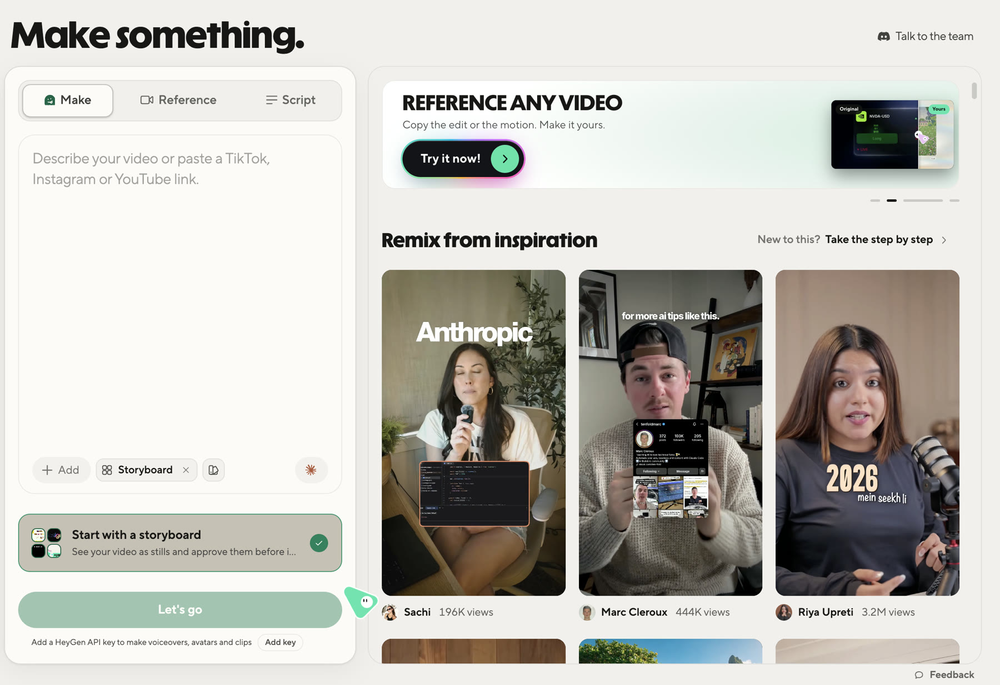
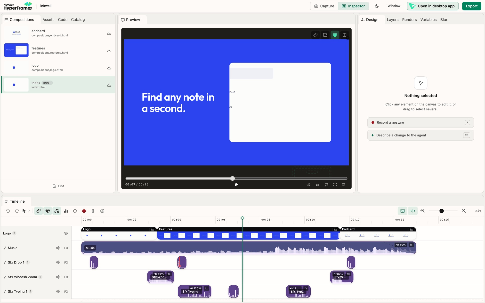
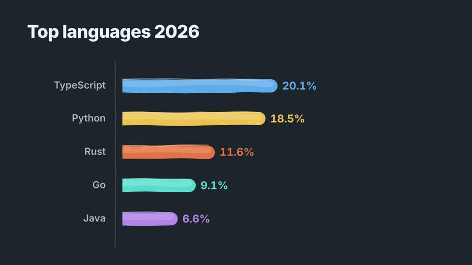

# hyperframes

[HyperFrames](https://github.com/heygen-com/hyperframes) 的文档层收录：一个面向 Agent 的开源 **HTML → 确定性 MP4** 框架。它负责工程结构、可 seek 动画、媒体/字幕、CLI 检查、Studio 和本地/云端渲染，不限定某一种视觉风格。



## 在本库中的位置

| 层 | 对应 Skill |
|---|---|
| 视觉风格与导演 | `lemo-opuscar`、`opus-video-skills` |
| 轻量自建 MV/Canvas 引擎与 Opus 工作流 | `code-mv-render` |
| 通用 composition / 媒体 / 批量 / 云渲染底座 | **`hyperframes`** |
| 最终视频扫描、源码映射与回归门禁 | `video-qa-frameproof` |

已有 `code-mv-render` 工程不必为了“统一”而迁移；需要多场景工程、媒体轨道、变量批量、Studio 或托管渲染时再选 HyperFrames。

## Studio 与数据视频

| Studio 编辑 | 数据视频工作流 |
|---|---|
|  |  |

## 快速开始

要求 Node.js 22+ 和 FFmpeg。为 Agent 安装核心 Skills，并在真实工程目录初始化：

```bash
npx hyperframes skills update
npx hyperframes init my-video
cd my-video
npx hyperframes preview
npx hyperframes render --quality delivery --output out.mp4
```

基本工程由根 `index.html`、`compositions/` 和 `assets/` 组成。使用 paused GSAP timeline 和 `data-*` 时间属性，渲染器在 headless Chrome 中逐帧 seek，再由 FFmpeg 编码。具体合同见 [composition-contract.md](references/composition-contract.md)。

典型生产闭环：

```bash
npx hyperframes lint
npx hyperframes check --json
npx hyperframes snapshot
npx hyperframes render --quality delivery --output out.mp4
```

还支持 Docker 严格渲染、变量批量、Lambda/Cloud Run 和云端工作流。具体在线能力依赖网络或第三方服务时，不将其描述为全离线。

## 收录边界

本目录仅包含导航、接入合同和上游预览图，不包含 HyperFrames CLI、Studio、渲染器、registry 组件或官方 Skills。实际使用请安装上游工具，并以其当前文档为准。

HyperFrames 是通用基础设施，并非 Opus 5.5 专属项目，也不保证任何模型自动产生同样的视觉质量。

## 来源与许可

- 上游：HeyGen / [heygen-com/hyperframes](https://github.com/heygen-com/hyperframes)
- 许可：[Apache-2.0](https://github.com/heygen-com/hyperframes/blob/main/LICENSE)
- 预览图：上游 `docs/public/images/studio-app/home.jpg`、`studio/editor-overview-v2.jpg`、`workflows/data-video.jpg`；仅调整本地文件名，画面未改动。
- 第三方组件、字体、素材、生成服务和用户内容的许可与隐私条款独立判断。
