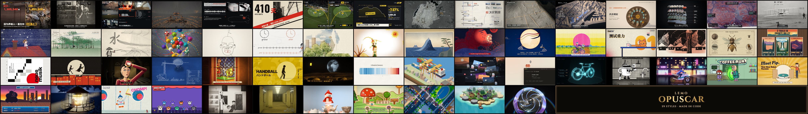
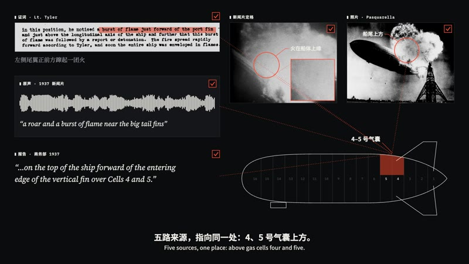
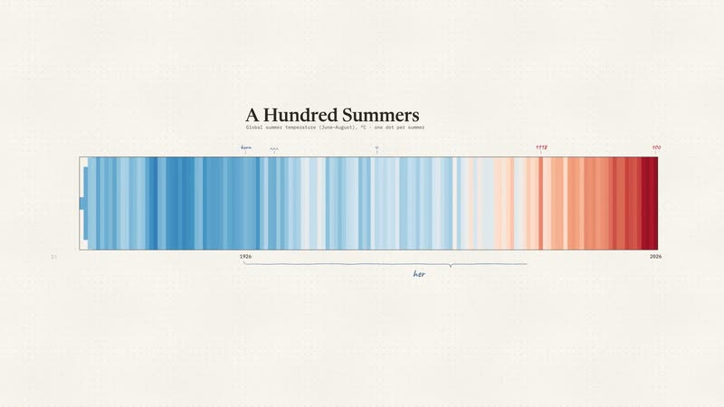

# lemo-opuscar

[Lemo-Opuscar](https://github.com/lemomo-ai/lemo-opuscar) 的文档层收录：一个以 Claude Opus 5.5 为导演、用 Canvas/WebGL 代码逐帧制作完整视频的 **59 风格工具箱**。

这里提供风格索引、选型与定制流程、上游安装入口和少量预览。完整导演规范、风格文件、脚本、依赖与示例保留在上游；本目录不是运行库的离线镜像。



## 快速选型

| 创作需求 | 优先查看 |
|---|---|
| 档案调查、新闻、历史证据 | `visual-investigation`、`caption-news`、`kino-montage` |
| 数据故事、产品发布、技术解释 | `dataviz`、`dark-keynote`、`iso-infographic` |
| 手绘角色、诗意叙事、MV | `watercolor`、`ink-wash`、`cel-anime-80s` |
| 东方视觉、节庆与神话 | `shadow-puppet`、`ukiyoe`、`papercut-red` |
| 产品、结构、空间与材质 | `teardown`、`white-model`、`glass-product` |
| 鲜明的图形与文字节奏 | `swiss-motion`、`pictogram-motion`、`ascii-crt` |

完整 59 种中英文名与 slug 见 [风格索引](references/style-index.md)。要加入品牌色、logo、IP 或建立新风格，见 [定制风格流程](references/custom-style.md)。

### 风格示例

| 中国水墨 | 视觉调查 | 数据叙事 |
|---|---|---|
|  |  |  |

## 使用方式

在 Claude Code 中安装上游完整插件：

```bash
claude plugin marketplace add lemomo-ai/lemo-opuscar
claude plugin install lemo-opuscar@lemolab
```

其他 Agent 可复制上游 [`plugin/skills/lemo-opuscar/`](https://github.com/lemomo-ai/lemo-opuscar/tree/main/plugin/skills/lemo-opuscar)，或 clone 上游仓库。需要 Node.js 20+、FFmpeg、Python 3.11+ 或 uv。

之后直接描述主题与风格，例如：

> 用中国水墨风格做一支 30 秒的短片，讲一位剑客沿河寻找故人的故事。

开始制作前确认主题、素材与是否需要故事板；实际渲染和验收遵循本目录 `SKILL.md` 以及上游 `DIRECTOR.md`、`TECHNIQUE.md` 和具体 `STYLE.md`。

## 收录边界

- 本库收录：选择指南、制作合同、少量预览、上游链接与署名说明。
- 上游提供：59 个 `STYLE.md`、完整 Skill、逐帧渲染与声音指南、样片及源码。
- 本目录未复制上游大型源码、样片、模型、音频和依赖；不能离线替代完整插件。
- 上游样例和风格由 Claude Opus 5.5 制作/调校，其他模型的适配度不由本库保证。

## 来源与许可

- 上游作者：Lemomo / LemoLab；上游：https://github.com/lemomo-ai/lemo-opuscar
- 代码和文档：MIT。上游样片与静帧：CC BY 4.0；第三方素材及部分配音有单独例外，复用前查看上游[授权说明](https://github.com/lemomo-ai/lemo-opuscar#%E6%8E%88%E6%9D%83)。
- 本目录预览来自上游 `docs/cover.jpg`、`docs/frames/ink-wash.jpg`、`visual-investigation.jpg`、`dataviz.jpg`，仅做本地路径调整，画面未改动。
- 预览署名：**LemoLab**，[Lemo-Opuscar](https://github.com/lemomo-ai/lemo-opuscar)，[CC BY 4.0](https://creativecommons.org/licenses/by/4.0/)。公开再分发这些图片时保留本署名；修改图片时另注明改动。
