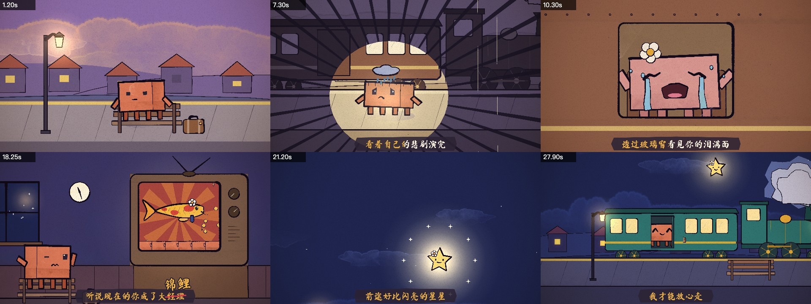
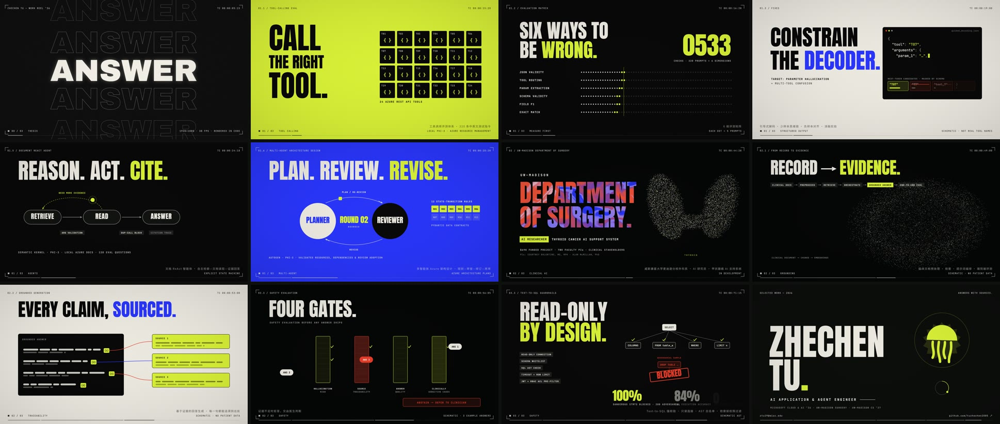

# opus-video-skills

[opus-video-skills](https://github.com/tuzhechen2005/opus-video-skills) 的文档层收录：两套面向 Claude Opus 5.5 的完整代码视频 Skill。图像和音乐均由程序化代码生成，不依赖图像、视频或音频生成模型。

本目录保留选型、制作合同与预览；完整可运行模板、逐帧渲染器、示例和脚本请从上游安装。

## 两种风格

### painted-animation — 水彩与水墨角色动画



p5.js + p5.brush 逐帧绘制，支持角色表情与动作、手绘短片、MV、逐字卡拉 OK 歌词视频和无缝循环。上游示例为 31 秒《小镇姑娘》歌词 MV。

适合：有角色、有情绪、有因果事件的叙事，以及需要笔刷材质而不是扁平几何图形的画面。

### kinetic-reel — 动态排版与 WebGL Reel



Canvas 2D 字体层结合 three.js 粒子地形、液态大理石、金属结和粒子云，使用形状连续转场与节拍锁定配乐。上游示例为 84 秒 “Work Reel ’26”。

适合：作品集、项目总结、产品宣传片和高能量片头；标题、HUD、视觉机制与声音共享一套时间数据。

## 安装与使用

在 Claude Code 中按需安装：

```bash
/plugin marketplace add tuzhechen2005/opus-video-skills
/plugin install painted-animation@opus-video-skills
/plugin install kinetic-reel@opus-video-skills
```

要求 Node.js、Google Chrome、FFmpeg；手绘速度检测另需 Python 3 + numpy。安装后用自然语言描述主题、素材、时长和比例，对应 Skill 会创建工程、提交故事板、逐镜审查并导出 MP4。

- [painted-animation 上游说明](https://github.com/tuzhechen2005/opus-video-skills/tree/main/skills/painted-animation)
- [kinetic-reel 上游说明](https://github.com/tuzhechen2005/opus-video-skills/tree/main/skills/kinetic-reel)
- [本库制作与 QA 合同](references/production.md)

## 收录边界

- 收录：选择指引、确定性逐帧/声音/审查约束、两张上游 contact sheet。
- 不收录：上游 `template/`、`render.mjs`、完整示例、依赖和成片；因此本目录自身不是离线渲染器。
- 两套 Skill 均由 Claude Opus 5.5 制作/调校。应区分“使用 Opus 5.5 开发”与“所有 Agent 运行时都必须同一模型”。

## 来源与许可

上游 MIT，见 [LICENSE](https://github.com/tuzhechen2005/opus-video-skills/blob/main/LICENSE)。`painted-animation` 的引擎与指南、`kinetic-reel` 的渲染器派生自 John Heibel 的 MIT 项目 [ClaudeAnimationBase](https://github.com/JohnHeibel/ClaudeAnimationBase)，方法参考 [PDoomVideo](https://github.com/JohnHeibel/PDoomVideo)；分发派生代码时保留原版权说明。

预览图来自上游两个 Skill 的 `docs/`，仅调整本地文件名，画面未修改。p5.js、p5.brush、three.js、Puppeteer、FFmpeg、字体、示例音乐/歌词与第三方素材的授权独立判断。
