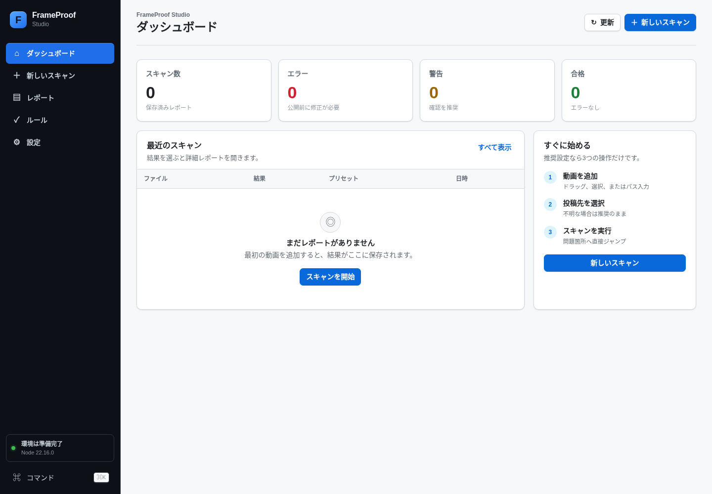
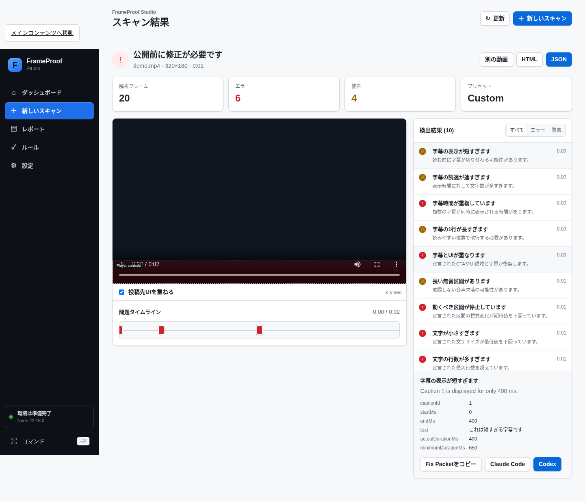

# video-qa-frameproof

[FrameProof Video QA](https://github.com/yocchi12345jp/frameproof-video-qa) 的文档层收录：针对代码或 Agent 生成视频的**源码感知验收、修复闭环和 revision gate**。

代码能编译、渲染器退出码为 0，并不代表 MP4 没有空帧、冻结、字幕重叠、异常静音或错误编码。FrameProof 将这些问题转为确定性 findings 和 Fix Packets，帮助 Agent 或人定位最小修复。



## 能检查什么

- 空帧、非预期冻结、边缘活动与宽高比。
- 字幕速度、时长、行数/行宽、重叠、时间越界和已声明 UI 区域碰撞。
- 最终导出的音轨存在性、静音区间、综合响度与 true peak。
- 分辨率、编码、像素格式、fps、时长、文件大小和平台预设。
- 通过 Render Manifest 检查预期运动、文字元数据、可见性、音频和安全区，并映射回源码。
- 通过 baseline 对比新增、恶化、改善、解决、不变和已接受问题。



## 三命令项目工作流

要求 Node.js 20+，FFmpeg 与 FFprobe 在 `PATH`：

```bash
npx frameproof-video-qa doctor
npx frameproof-video-qa init --video out/video.mp4
npx frameproof-video-qa verify
```

报告与修复包输出到 `.frameproof/artifacts/latest`。需要可视化检查、复制修复提示或管理 baseline 时：

```bash
npx frameproof-video-qa studio
```

 reviewed 当前成片后，才将报告设为基准：

```bash
npx frameproof-video-qa baseline set .frameproof/artifacts/latest/report.json
npx frameproof-video-qa baseline status
```

文件级扫描、manifest、CI 和修复流程见 [verify-and-repair.md](references/verify-and-repair.md)。

## 与本库其他 Skill 配合

`code-mv-render`、`opus-video-skills` 或 `hyperframes` 负责生成视频；FrameProof 负责最终导出验收。它也可以扫描其他工具制作的 MP4，核心扫描不要求 Remotion。

它不能替代创作、审美判断、OCR、完整广播 QC、VMAF 或人工看图/听审。修复后必须重渲并复检，不能仅调宽阈值或覆盖 baseline 来通过 CI。

## 收录边界与许可

本目录只保存导航、QA 合同和两张上游截图，不包含 CLI、Studio、GitHub Action 或上游 Agent Skill。实际使用请调用上游包。

- 上游：[yocchi12345jp/frameproof-video-qa](https://github.com/yocchi12345jp/frameproof-video-qa)
- 许可：[MIT](https://github.com/yocchi12345jp/frameproof-video-qa/blob/main/LICENSE)
- 预览：上游 `docs/images/v0.4/studio-dashboard-v0.4.png`、`studio-source-aware-result-v0.4.png`，仅调整本地文件名，画面未改动。
- FrameProof 是通用生成后 QA，不是 Opus 5.5 专属工具。
